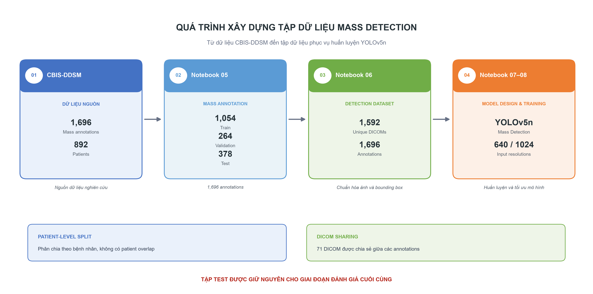
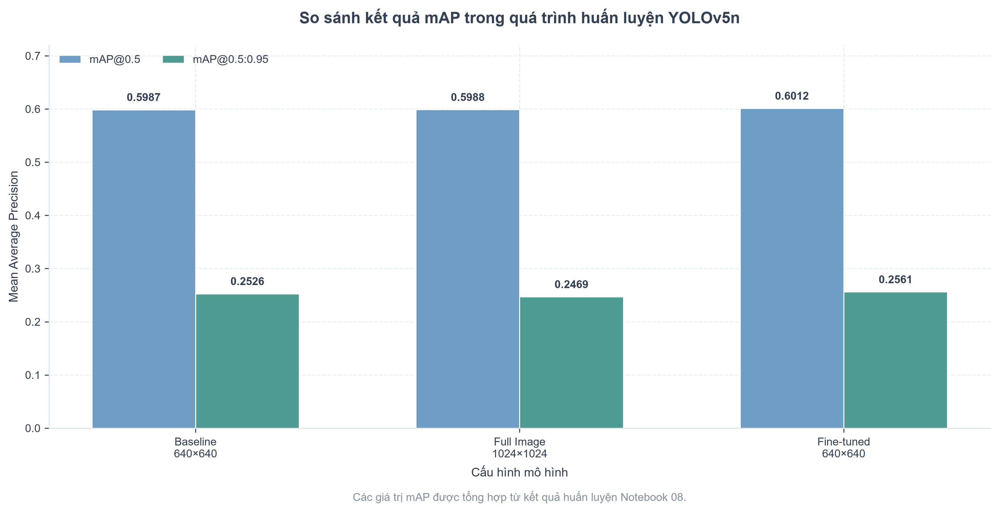
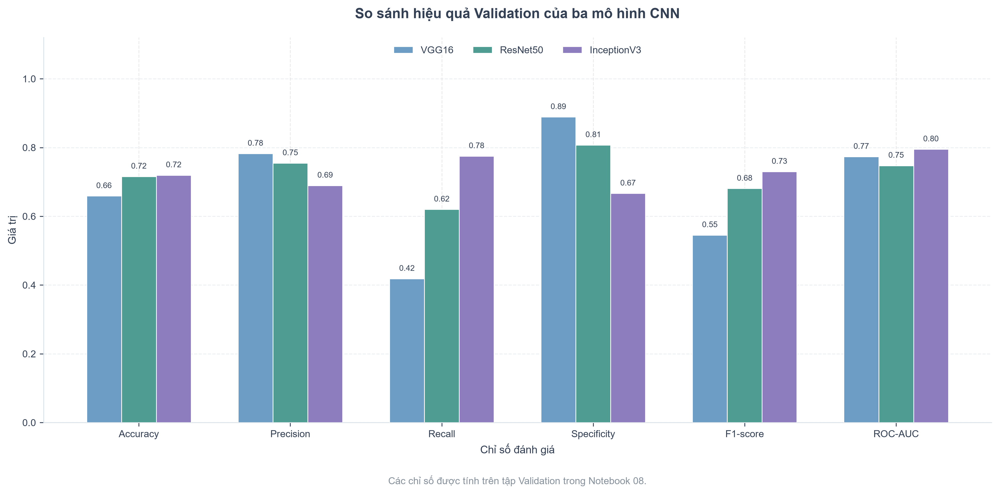
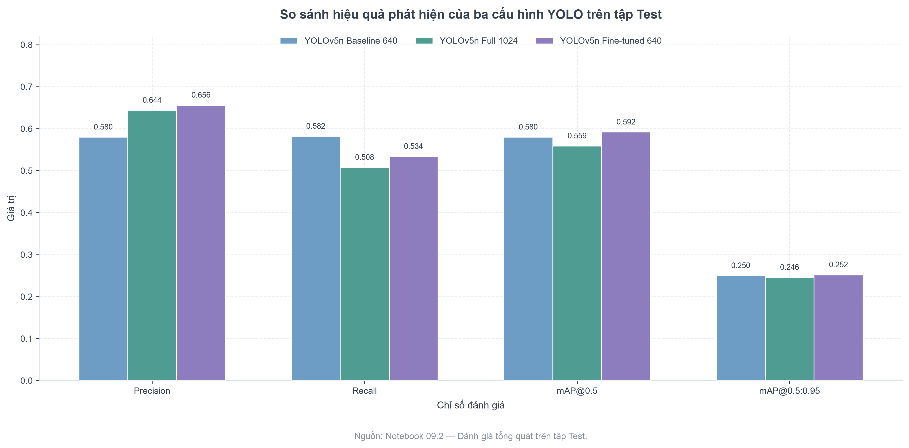
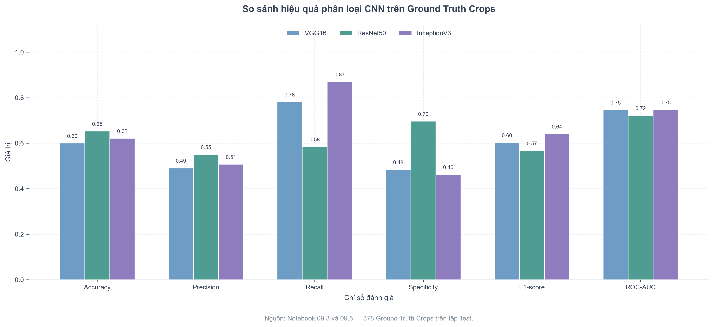
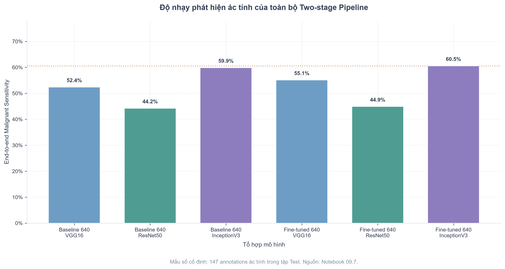
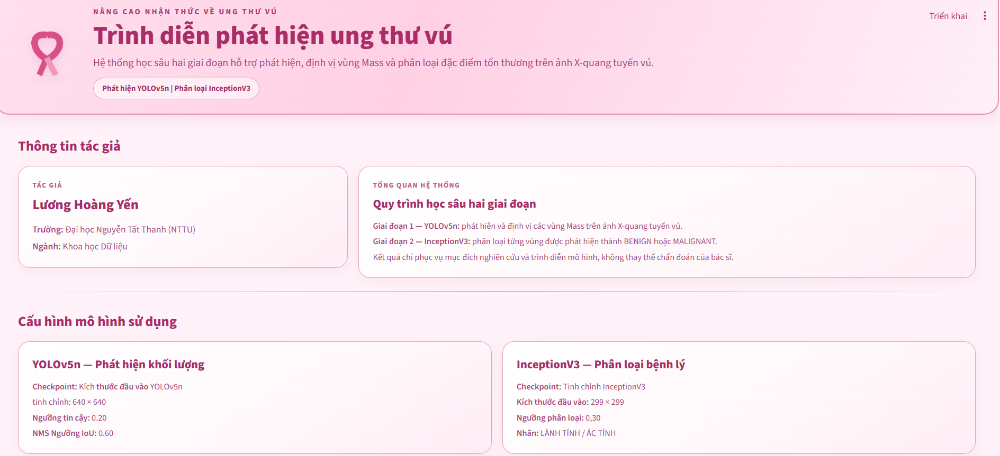

# Xây dựng mô hình học sâu phát hiện và định vị tổn thương có chọn lọc lành tính và ác tính trên ảnh X-quang tuyến vú


Khóa luận tốt nghiệp ngành Khoa học dữ liệu — 2026.

## 1. Giới thiệu

Dự án nghiên cứu và xây dựng mô hình học sâu theo kiến trúc hai giai đoạn (*Two-stage Pipeline*) nhằm phát hiện, định vị tổn thương Mass và phân loại bản chất lành tính hoặc ác tính trên ảnh X-quang tuyến vú.

Nguồn dữ liệu sử dụng là **CBIS-DDSM (Curated Breast Imaging Subset of DDSM)** từ The Cancer Imaging Archive (TCIA).

Phạm vi thực nghiệm chính tập trung vào tổn thương Mass. Hệ thống gồm:

- **Stage 1 — Detection & Localization:** YOLOv5n phát hiện và định vị vùng Mass.
- **Stage 2 — Pathology Classification:** VGG16, ResNet50 và InceptionV3 phân loại vùng Mass thành BENIGN hoặc MALIGNANT.

> **Lưu ý:** Đây là sản phẩm nghiên cứu học thuật, không phải thiết bị y tế và không thay thế đánh giá hoặc chẩn đoán của bác sĩ.

## 2. Dataset

Nguồn dữ liệu: [CBIS-DDSM — The Cancer Imaging Archive](https://www.cancerimagingarchive.net/collection/cbis-ddsm/).

Dự án khai thác ảnh DICOM, metadata, full images, cropped images, ROI masks và pathology annotations.

### 2.1. Quy mô dữ liệu Mass

| Thành phần | Số lượng |
|---|---:|
| Mass annotations | 1.696 |
| Full images duy nhất | 1.592 |
| Bệnh nhân | 892 |
| Train annotations | 1.054 |
| Validation annotations | 264 |
| Test annotations | 378 |

### 2.2. Phân chia dữ liệu

| Tập dữ liệu | Annotations | Ảnh | Bệnh nhân |
|---|---:|---:|---:|
| Train | 1.054 | 982 | 552 |
| Validation | 264 | 249 | 139 |
| Test | 378 | 361 | 201 |

Dữ liệu được chia theo Patient ID nhằm tránh một bệnh nhân xuất hiện đồng thời ở nhiều tập. Kiểm tra trong quá trình huấn luyện CNN xác nhận không có Patient ID trùng giữa Train, Validation và Test.

### 2.3. Nhãn phân loại

Nhãn pathology gốc gồm:

- `BENIGN`
- `BENIGN_WITHOUT_CALLBACK`
- `MALIGNANT`

Trong thí nghiệm phân loại nhị phân:

- `BENIGN` và `BENIGN_WITHOUT_CALLBACK` được ánh xạ thành `BENIGN`.
- `MALIGNANT` được giữ riêng.

Tập Test có 378 crops, gồm 231 BENIGN và 147 MALIGNANT.

**Quy trình xây dựng tập dữ liệu**



<sub>Hình 2.1. Quy trình xây dựng tập dữ liệu phục vụ thực nghiệm. Nguồn: Notebook 10 — mục 10.3, hình 04.</sub>

Ảnh CBIS-DDSM và các checkpoint huấn luyện không được lưu trong repository. Người dùng cần tự chuẩn bị dữ liệu từ nguồn TCIA và tuân thủ chính sách sử dụng, trích dẫn của nguồn dữ liệu.

## 3. Phương pháp nghiên cứu

### 3.1. Stage 1 — Mass Detection & Localization

Sử dụng YOLOv5n với một lớp phát hiện `Mass`.

Các cấu hình được khảo sát:

| Cấu hình | Input size | Batch size | Epoch thực tế |
|---|---:|---:|---:|
| Baseline | 640 × 640 | 4 | 30 |
| Full training | 1024 × 1024 | 1 | 30 |
| Fine-tuned | 640 × 640 | 4 | 12 |

Fine-tuning sử dụng checkpoint Baseline, learning rate 0,001, tối đa 20 epochs và early stopping patience 8.

Các thông số chung gồm SGD, seed 42 và workers 0.

**Kết quả huấn luyện YOLOv5n**



<sub>Hình 3.1. So sánh kết quả huấn luyện các cấu hình YOLOv5n. Nguồn: Notebook 10 — mục 10.4, hình 01.</sub>

### 3.2. Stage 2 — Pathology Classification

So sánh ba kiến trúc CNN được khởi tạo từ pretrained ImageNet:

| Mô hình | Input size | Batch size | Best epoch | Epoch thực tế |
|---|---:|---:|---:|---:|
| VGG16 | 224 × 224 | 8 | 3 | 10 |
| ResNet50 | 224 × 224 | 8 | 10 | 17 |
| InceptionV3 | 299 × 299 | 8 | 8 | 15 |

Cấu hình huấn luyện chung:

- Optimizer: AdamW.
- Backbone learning rate: 1e-5.
- Classifier learning rate: 1e-4.
- Weight decay: 1e-4.
- Maximum epochs: 30.
- Early stopping patience: 7.
- Scheduler: ReduceLROnPlateau.
- Random seed: 42.
- Mixed precision training.

Các vùng Mass được trích xuất từ Ground Truth Bounding Box, mở rộng thêm 10% vùng biên ngữ cảnh.

**So sánh kết quả huấn luyện và Validation của ba mô hình CNN**



<sub>Hình 3.2. So sánh các chỉ số đánh giá Validation của VGG16, ResNet50 và InceptionV3. Nguồn: Notebook 10 — mục 10.4, hình 02.</sub>

## 4. Kết quả thực nghiệm

### 4.1. YOLOv5n — Detection trên Test

| Mô hình | Precision | Recall | F1-score | mAP@0.5 | mAP@0.5:0.95 |
|---|---:|---:|---:|---:|---:|
| Baseline 640 | 0,580 | **0,582** | 0,581 | 0,580 | 0,250 |
| Full 1024 | 0,644 | 0,508 | 0,568 | 0,559 | 0,246 |
| Fine-tuned 640 | **0,656** | 0,534 | **0,589** | **0,592** | **0,252** |

Các chỉ số trên được đánh giá bằng YOLOv5 validation script với confidence threshold 0,001 và NMS IoU 0,60.

Fine-tuned 640 đạt Precision và mAP cao nhất, trong khi Baseline 640 duy trì Recall cao nhất. Việc tăng input size lên 1024 chưa tạo ra lợi thế tổng quát hóa vượt trội trên tập Test.

**Đánh giá hiệu quả phát hiện trên tập Test**



<sub>Hình 4.1. So sánh các chỉ số đánh giá Detection của các cấu hình YOLOv5n trên tập Test. Nguồn: Notebook 10 — mục 10.5, hình 01.</sub>

### 4.2. CNN — Classification trên Ground Truth Crops

| Mô hình | Threshold | Accuracy | Precision | Recall | Specificity | F1-score | ROC-AUC |
|---|---:|---:|---:|---:|---:|---:|---:|
| VGG16 | 0,30 | 0,6005 | 0,4915 | 0,7823 | 0,4848 | 0,6037 | 0,7469 |
| ResNet50 | 0,50 | **0,6534** | **0,5513** | 0,5850 | **0,6970** | 0,5677 | 0,7225 |
| InceptionV3 | 0,30 | 0,6217 | 0,5079 | **0,8707** | 0,4632 | **0,6416** | **0,7475** |

Các ngưỡng phân loại được lựa chọn từ tập Validation và giữ cố định khi đánh giá Test.

InceptionV3 đạt Recall, F1-score và ROC-AUC cao nhất. ResNet50 đạt Accuracy, Precision và Specificity cao nhất. Kết quả cho thấy sự khác biệt về đặc tính phân loại giữa các kiến trúc, không có mô hình dẫn đầu trên mọi tiêu chí.

**So sánh hiệu quả phân loại trên Ground Truth Crops**



<sub>Hình 4.2. So sánh hiệu quả phân loại của VGG16, ResNet50 và InceptionV3 trên Ground Truth Crops. Nguồn: Notebook 10 — mục 10.6, hình 01.</sub>

### 4.3. Two-stage Pipeline

Các mô hình CNN tiếp tục được đánh giá trên Predicted Detection Crops để khảo sát ảnh hưởng của bước phát hiện và định vị đến kết quả phân loại.

| Cấu hình | Matched crops | CNN F1-score | E2E Malignant Sensitivity |
|---|---:|---:|---:|
| Baseline 640 + InceptionV3 | 206 | 0,7273 | 88/147 — 59,86% |
| Fine-tuned 640 + InceptionV3 | 226 | 0,6926 | **89/147 — 60,54%** |

Trong sáu tổ hợp YOLO-CNN được khảo sát, Fine-tuned YOLOv5n 640 kết hợp InceptionV3 đạt End-to-End Malignant Sensitivity cao nhất.

Chỉ số này được tính trên 147 annotations MALIGNANT của tập Test, phản ánh khả năng nhận diện đúng qua hai giai đoạn. Đây không phải chỉ số xác nhận hiệu quả chẩn đoán lâm sàng.

**So sánh hiệu quả toàn bộ Two-stage Pipeline**



<sub>Hình 4.3. So sánh End-to-End Malignant Sensitivity giữa các tổ hợp YOLO-CNN. Nguồn: Notebook 10 — mục 10.7, hình 01.</sub>

### 4.4. Phân tích lỗi

Kết quả thực nghiệm cho thấy:

- Giai đoạn phát hiện vẫn là một nguồn bỏ sót tổn thương quan trọng.
- Fine-tuning giúp tăng số lượng tổn thương được ghép đúng nhưng cũng làm tăng số dự đoán không khớp Ground Truth.
- InceptionV3 có Recall cao nhưng phát sinh nhiều False Positive hơn ResNet50 trên Ground Truth Crops.
- Đánh giá CNN trên Predicted Crops chỉ phản ánh các vùng được phát hiện và ghép đúng; các Detection False Positive được báo cáo riêng, không tự động gán nhãn pathology.

Các phân tích lỗi chi tiết được lưu trong kết quả thực nghiệm và các notebook đánh giá tương ứng, phục vụ quá trình nghiên cứu và hoàn thiện khóa luận.

## 5. Web Demo

Ứng dụng được xây dựng bằng Streamlit nhằm minh họa quy trình phát hiện Mass và phân loại BENIGN/MALIGNANT.

**Giao diện ứng dụng Web Demo**



<sub>Hình 5.1. Giao diện ứng dụng Web Demo phục vụ thử nghiệm quy trình phát hiện và phân loại tổn thương. Nguồn: Notebook 11 — Web Demo.</sub>

Mô hình sử dụng trong Web Demo:

- YOLOv5n Fine-tuned 640 × 640.
- InceptionV3 299 × 299.
- Confidence threshold của YOLOv5n: 0,20.
- NMS IoU: 0,60.
- Classification threshold của InceptionV3: 0,30.

Các chức năng chính:

- Chọn ảnh từ tập Test hoặc tải ảnh lên.
- Hỗ trợ ảnh JPG, PNG và DICOM theo quy trình tiền xử lý.
- Hiển thị Bounding Box và confidence của vùng Mass được phát hiện.
- Hiển thị kết quả phân loại BENIGN/MALIGNANT cùng xác suất dự đoán.
- Đối chiếu Ground Truth khi ảnh thuộc tập Test có annotation đã xác minh.

Ảnh tải lên không có Ground Truth được xác minh chỉ hiển thị kết quả dự đoán, không tự tạo nhãn thật.

> Web Demo phục vụ mục đích nghiên cứu, thử nghiệm và giáo dục, không phải công cụ chẩn đoán y khoa.

## 6. Quy trình và cấu trúc Notebook

| Notebook | Nội dung |
|---|---|
| 01 | Kiểm kê dữ liệu |
| 02 | Kiểm định chất lượng và liên kết dữ liệu |
| 03 | Xây dựng cấu trúc dữ liệu tổn thương |
| 04 | Phân tích dữ liệu và xác định phạm vi nghiên cứu |
| 05 | Xây dựng Mass Experimental Dataset |
| 06 | Tiền xử lý ảnh và xây dựng Detection Labels |
| 07 | Thiết kế mô hình và chiến lược thực nghiệm |
| 08 | Huấn luyện và tối ưu mô hình |
| 09 | Đánh giá mô hình và phân tích lỗi |
| 10 | Trực quan hóa nghiên cứu và trình bày kết quả |
| 11 | Phát triển Web Demo |

Các Notebook được lưu trong thư mục `notebooks/` của repository.

## 7. Môi trường và khả năng tái lập

Môi trường thực nghiệm:

| Thành phần | Phiên bản / Thông tin |
|---|---|
| Operating System | Windows 10 |
| Python | 3.11.18 |
| PyTorch | 2.5.1+cu121 |
| TorchVision | 0.20.1+cu121 |
| CUDA Runtime | 12.1 |
| GPU | NVIDIA GeForce RTX 4050 Laptop GPU |
| VRAM | Khoảng 6 GB |
| YOLOv5 | v7.0 |

YOLOv5 source được ghim tại commit:

`915bbf294bb74c859f0b41f1c23bc395014ea679`

Tạo môi trường:

```bash
conda env create -f environment.yml
conda activate cbis-thesis
python -m ipykernel install --user --name cbis-thesis --display-name "Python (cbis-thesis)"
```

Cài YOLOv5:

```bash
git clone https://github.com/ultralytics/yolov5.git external/yolov5
git -C external/yolov5 checkout 915bbf294bb74c859f0b41f1c23bc395014ea679
```

PyTorch/CUDA có thể cần điều chỉnh theo phần cứng và môi trường thực tế. Tham khảo [PyTorch — Get Started](https://pytorch.org/get-started/locally/).

## 8. Dữ liệu và mô hình

Repository không phân phối ảnh DICOM gốc, dữ liệu xử lý, các checkpoint huấn luyện hoặc toàn bộ artifacts thực nghiệm.

Người dùng cần chuẩn bị dữ liệu và checkpoint theo đúng cấu trúc đường dẫn mà các notebook và ứng dụng yêu cầu.

Các kết quả thực nghiệm chi tiết, biểu đồ, bảng đánh giá và báo cáo phân tích lỗi được tạo từ Notebook 08–10.

Các hình ảnh được lựa chọn để minh họa trong README có nguồn gốc từ output thực nghiệm của Notebook 10 và ảnh chụp ứng dụng từ Notebook 11. Các tệp hình được lưu tại:

```text
Data/
└── processed/
    ├── nb10_research_visualization/
    │   └── figures/
    │       ├── nb10_3_figure_04_dataset_construction_pipeline.png
    │       ├── nb10_4_figure_01_yolo_map_comparison.png
    │       ├── nb10_4_figure_02_cnn_validation_metrics.png
    │       ├── nb10_5_figure_01_yolo_test_metrics.png
    │       ├── nb10_6_figure_01_cnn_ground_truth_comparison.png
    │       └── nb10_7_figure_01_two_stage_e2e_sensitivity.png
    └── nb11_web_demo/
        └── figures/
            └── web_demo_interface.png
```

Các hình ảnh trên được sử dụng trực tiếp thông qua đường dẫn tương đối trong repository. Những dữ liệu và mô hình có dung lượng lớn được quản lý riêng, không đưa vào repository.

## 9. Giới hạn nghiên cứu

- Phạm vi mô hình chính tập trung vào tổn thương Mass, không khẳng định xử lý đầy đủ mọi dạng tổn thương tuyến vú.
- Quy mô dữ liệu còn hạn chế và hiệu năng có thể thay đổi khi áp dụng trên nguồn ảnh khác.
- Kết quả trên CBIS-DDSM không tự động khái quát sang các cơ sở dữ liệu, thiết bị chụp hoặc quần thể bệnh nhân khác.
- Sai số của bước phát hiện có thể ảnh hưởng đến kết quả phân loại ở giai đoạn tiếp theo.
- Các chỉ số thực nghiệm không thay thế đánh giá chuyên môn hoặc chẩn đoán lâm sàng.

## 10. Tài liệu tham khảo và nguồn dữ liệu

Sawyer-Lee, R., Gimenez, F., Hoogi, A., & Rubin, D. (2016). *A curated mammography data set for use in computer-aided detection and diagnosis research.*

The Cancer Imaging Archive (TCIA): [CBIS-DDSM collection](https://www.cancerimagingarchive.net/collection/cbis-ddsm/).

DOI: [10.7937/K9/TCIA.2016.7O02S9CY](https://doi.org/10.7937/K9/TCIA.2016.7O02S9CY).

Người sử dụng dữ liệu cần tuân thủ chính sách, hạn chế và yêu cầu trích dẫn của TCIA.

---

**Người thực hiện: Lương Hoàng Yến · Khóa luận tốt nghiệp · Khoa học dữ liệu · 2026**